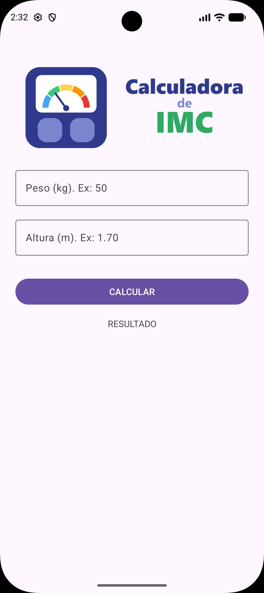
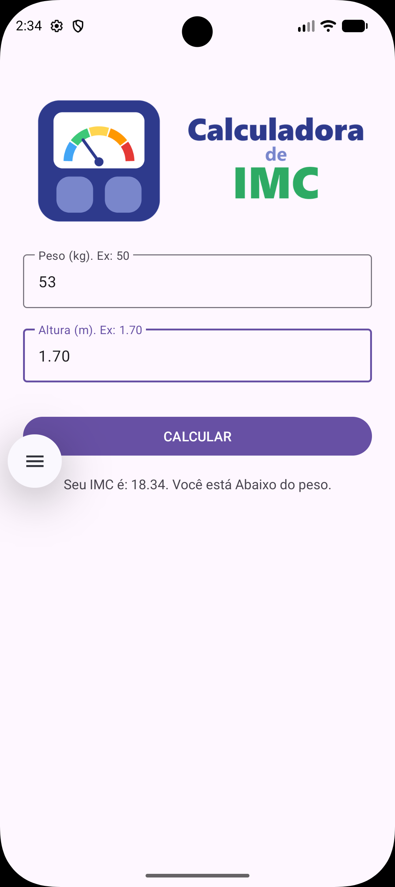
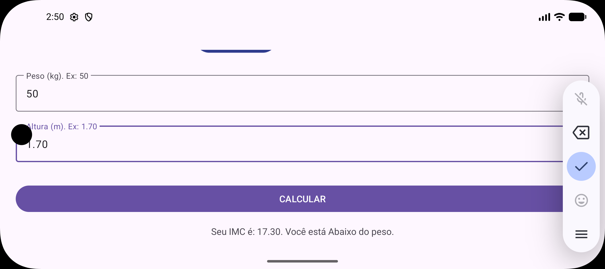

# Calculadora de IMC

App Android que calcula o Índice de Massa Corporal e mostra a classificação.
Projeto de estudo de Kotlin, MVVM e Clean Architecture.

## Prints






## Tecnologias

- Kotlin
- MVVM (ViewModel + LiveData)
- ViewBinding
- Testes unitários com JUnit

## Arquitetura

```
presentation/   MainActivity e ImcViewModel
domain/         CalcularImcUseCase (regras do IMC)
```

O app usa MVVM dentro de uma Clean Architecture simplificada:

- **View** (`MainActivity`): lê o peso e a altura digitados e entrega
para o ViewModel. Também observa o resultado e mostra na tela.
- **ViewModel** (`ImcViewModel`): valida os dados (campos vazios, vírgula 
ou ponto), pede o cálculo ao Domain e guarda o resultado em um `LiveData`.
- **Domain** (`CalcularImcUseCase`): contém a regra de negócio (a fórmula e
as faixas de classificação do IMC). É Kotlin puro, sem dependências do Android e
é por isso que é fácil de testar.

Quando a tela gira a Activity é destruída e recriada, mas o ViewModel sobrevive.
A nova Activity volta a observar o mesmo `LiveData` e o resultado continua na tela.

## Testes

O `CalcularImcUseCase` tem testes unitários, incluindo a fronteira
entre as faixas (IMC 18,5 = Peso normal).